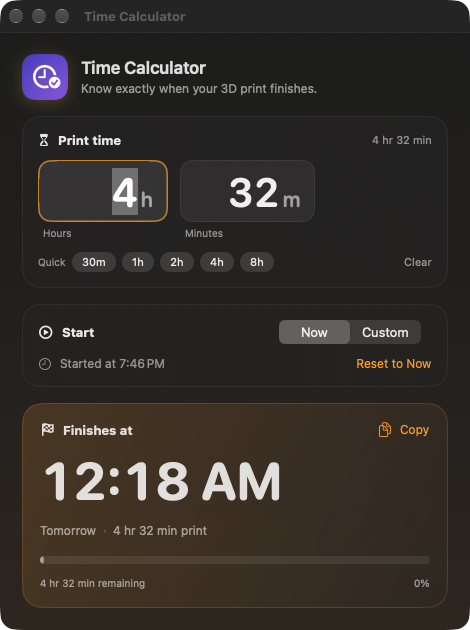
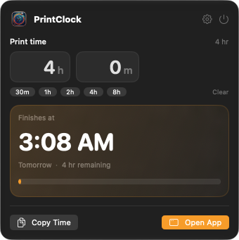
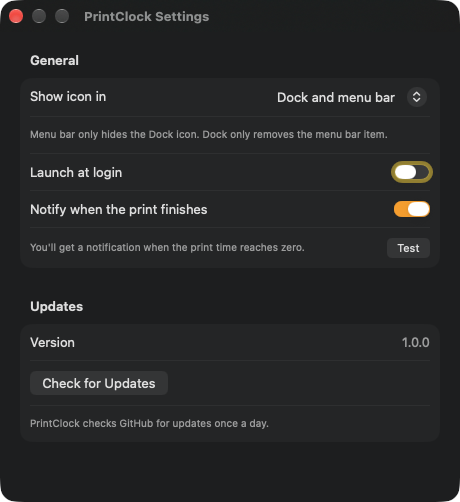

# PrintClock

A small native macOS app for 3D printing: enter the print time reported by your
slicer and see exactly what time the print will finish.



Click the clock in the menu bar for a compact calculator that stays in sync with the main window.



Settings covers launch at login, finished-print notifications, and update checks.



## Features

- Enter print time in hours and minutes, with quick presets
- Finish time updates live, with a countdown and progress bar
- Start now, or choose a custom start date and time
- Menu bar extra for quick access, synced with the main window
- Notification when the timer reaches zero, with a Test button
- Launch at login
- Automatic daily update check, plus a manual Check for Updates button
- Remembers your last duration between launches
- Copy the finish date and time to the clipboard (⇧⌘C)

## Updates

PrintClock checks the GitHub releases for `frankt2012/PrintClock` once a day.
Use **Settings → Check for Updates** to check immediately. A newer release
shows a Download button that opens the release page.

## Notifications

The first time you enter a print time, macOS asks for notification permission.
You can confirm everything works with **Settings → Test**.

## Menu bar

The app adds a clock-with-check icon to the menu bar. If you use a menu bar
manager such as Thaw, make sure the PrintClock item is in the visible
section.

## Install

Download the latest DMG from the
[releases page](https://github.com/frankt2012/PrintClock/releases/latest), or
install with Homebrew:

```sh
brew tap frankt2012/printclock
brew trust frankt2012/printclock
brew install --cask printclock
```

Homebrew asks you to trust third-party taps once before installing.

PrintClock requires macOS 14 Sonoma or later. DMG installs are not notarized,
so on first launch right-click the app in Applications and choose **Open**. The
Homebrew cask removes the download quarantine for you.

## Build

The project is generated with [XcodeGen](https://github.com/yonaskolb/XcodeGen).

```sh
xcodegen generate
open PrintClock.xcodeproj
```

Or build from the command line:

```sh
xcodegen generate
xcodebuild -project PrintClock.xcodeproj -scheme PrintClock -configuration Release build
```

The built app appears in Xcode's DerivedData folder, or use **Product → Show Build Folder in Finder** from Xcode.

## Tests

```sh
swift test --package-path Packages/PrintClockKit
```
