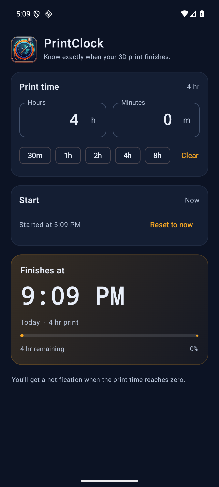
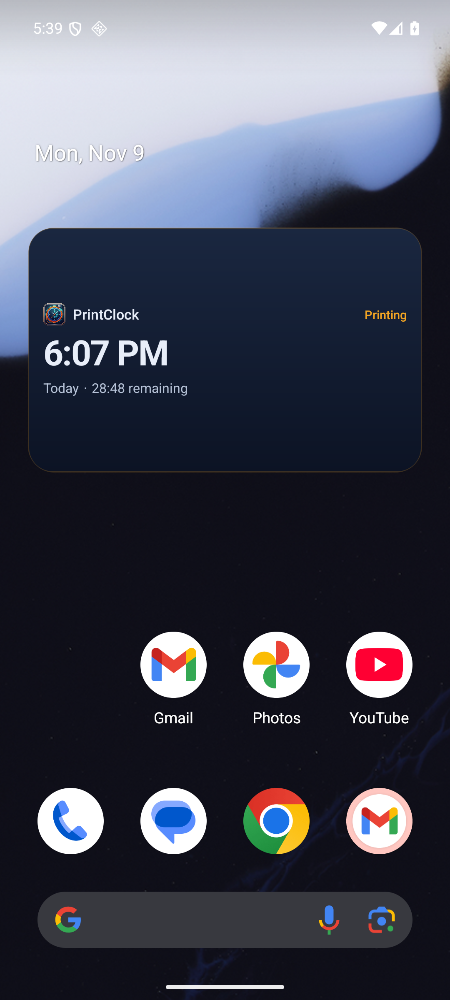

# PrintClock for Android

An early native Android version of PrintClock, built with Kotlin and Jetpack
Compose. Enter the time reported by your slicer and see exactly when the print
will finish.



## What's here

- Duration entry with quick presets
- Live finish time, day, countdown, and progress
- Active timer survives an app restart
- Home-screen widget with a native live countdown
- Local notification scheduled for the finish time
- Exact alarms when the system allows them
- Boot-time rescheduling so the alarm and widget survive a restart
- Dark Material 3 UI using the same artwork as the macOS app



Add the widget by long-pressing the home screen, choosing **Widgets**, then
selecting **PrintClock**.

## Not here yet

This is the first Android milestone. Still to come:

- Custom start date and time
- Quick Settings tile
- Optional finish notification toggle
- In-app update check
- Release signing and a published APK

## Build

Requires JDK 17+ and Android SDK 36.

```sh
cd android
JAVA_HOME=/opt/homebrew/opt/openjdk@21 ./gradlew :app:assembleDebug
```

Install the debug APK on a running emulator or device:

```sh
adb install -r app/build/outputs/apk/debug/app-debug.apk
```

Run the unit tests:

```sh
JAVA_HOME=/opt/homebrew/opt/openjdk@21 ./gradlew :app:testDebugUnitTest
```

## Notes

- Android 13+ asks for notification permission when a print is started.
- For an on-time alert, the manifest declares exact-alarm access. If the
  system does not grant it, PrintClock falls back to an inexact alarm.
- `USE_EXACT_ALARM` is appropriate for this timer, but Play Store policy
  restricts it. A Play release would need a user-granted
  `SCHEDULE_EXACT_ALARM` flow instead.
